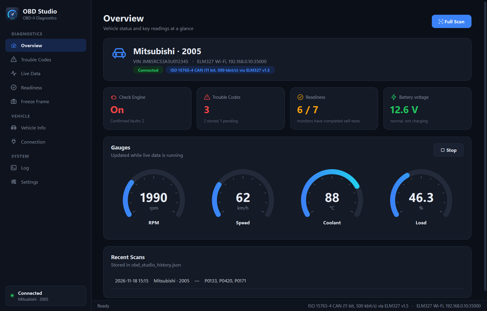

**English** | [Українська](README.uk.md)

# OBD Studio

OBD Studio is a free Windows app that turns a laptop and an inexpensive adapter into a car
diagnostic tool. It reads trouble codes and explains them in plain language, shows whether
the Check Engine light is on, checks the emission self-tests that matter for inspection, and
displays live engine data with gauges and charts. It works with any make that supports the
standard OBD-II protocol, through a KKL cable or an ELM327 adapter (USB, Bluetooth or Wi-Fi).
No installation is needed: download one `.exe` file and run it.



## Features

- **Overview**: make and year (decoded from the VIN), Check Engine light, number of trouble
  codes, readiness of the self-tests, battery voltage (ELM327), gauges and scan history.
- **Full Scan** with one click: readiness, stored codes, pending codes, permanent codes
  (CAN cars only) and the freeze frame.
- **Trouble Codes** with plain-language descriptions (over 250 codes), type and an estimated
  severity. For manufacturer codes the app takes the car make into account.
- **Live Data**: over 50 parameters (RPM, temperatures, fuel trims, oxygen sensors, pressures,
  voltage and more), a chart, mini-charts, a parameter picker and **CSV recording**.
- **Freeze Frame** (mode 02): the conditions at the moment a fault was stored.
- **Vehicle Info** (mode 09): VIN, calibration ID, CVN, control unit name; make, region and
  model year decoded from the VIN.
- **HTML report** you can print or save as PDF, and a technical **log** for troubleshooting.
- Dark and light themes. English and Ukrainian interface.

## Supported adapters

| Adapter | Protocols | Cars |
|---|---|---|
| **KKL cable** (VAG KKL 409.1, FTDI chip) | K-line: ISO 9141-2, ISO 14230 KWP2000 | mostly cars before ~2008 |
| **ELM327 USB / Bluetooth** | all OBD-II protocols, including CAN | any OBD-II car, including 2008 and newer |
| **ELM327 Wi-Fi** | all OBD-II protocols, including CAN | any OBD-II car |

Not sure which one you need? See [Choosing an adapter](docs/user-guide.en.md#2-choosing-an-adapter)
in the user guide.

## Download & run

1. Open the [Releases page](https://github.com/DenisKrav/obd-studio/releases) and download
   `OBDStudio.exe` from the latest release.
2. Put it in any folder you like (for example `Documents\OBD Studio`) and double-click it.
   There is nothing to install.
3. Windows may show a blue "Windows protected your PC" (SmartScreen) window because the app is
   not signed. Click **More info → Run anyway**. This happens with every unsigned program.

Requirements: Windows 10 or 11, a KKL cable or an ELM327 adapter.

## Quick start

1. Plug the adapter into the car's diagnostic socket (usually under the steering wheel) and
   switch the ignition on. You don't need to start the engine.
2. Close other diagnostic programs (VCDS-Lite, Torque, etc.) — they block the port.
3. Start OBD Studio, open **Connection** and choose your adapter. Pick the COM port
   (KKL / USB / Bluetooth) or check the Wi-Fi address (ELM327 Wi-Fi).
4. Click **Connect**. With a KKL cable this can take up to 20 seconds.
5. Open **Overview** and click **Full Scan**.

The full step-by-step guide is here: **[User guide](docs/user-guide.en.md)**
([Українською](docs/user-guide.uk.md)).

## Is it safe for my car?

OBD Studio sends **only standard, read-only OBD-II requests** (modes 01, 02, 03, 07, 09, 0A).
The only command that changes anything in the control unit is **clearing trouble codes**
(mode 04), and the app sends it only after you confirm. There are no manufacturer-specific
commands: the app does not code, adapt or reprogram anything.

## Files next to the program

The app keeps its files **in the same folder as `OBDStudio.exe`**. If you move the program,
move these files with it, or your settings and history will start from scratch.

| File | What's inside |
|---|---|
| `obd_studio_settings.json` | adapter, port, car make, theme, language, live data parameters, K-line timing |
| `obd_studio_history.json` | scan history (up to 300 entries) |

Settings from the earlier version (`lancer_obd_settings.json`) are picked up automatically.

Because of this, keep the exe in a folder where you can write files (not in `C:\Program Files`).

## FAQ and troubleshooting

**The COM port list is empty.** The adapter's driver is not installed, or the adapter isn't
plugged in. Check Windows Device Manager → "Ports (COM & LPT)", then click the refresh button
next to the port list.

**The app can't open the port.** Another program is using the port. Close VCDS-Lite, Torque and
similar programs, or unplug and replug the adapter.

**The KKL cable doesn't answer.** The cable is powered by the car: switch the ignition on.
Without 12 V from the socket it stays silent.

**ELM327 doesn't respond.** Make sure you chose the right port. For Bluetooth, use the
*outgoing* COM port of the paired adapter.

**"UNABLE TO CONNECT".** The adapter works, but the car didn't answer. Switch the ignition on,
check that the plug sits firmly and try again. Very old cars may not support OBD-II at all.

**Nothing helps.** Open **Log → Save Log** and send the `.txt` file along with your question.
It contains every byte sent and received, so the problem can be found.

More answers: [Troubleshooting](docs/user-guide.en.md#11-troubleshooting) in the user guide.

---

## For developers

### Project structure

```
main.py                   entry point
obd_studio/
  config.py               Timing (K-line timing), AppSettings, saving
  protocol.py             checksum, KWP2000 / ISO 9141-2 frame parsing, ObdError
  kline.py                KLine: KKL cable, echo, fast/slow init, reconnect
  elm327.py               Elm327: USB/Bluetooth/Wi-Fi, AT commands, CAN and ISO-TP
  obd.py                  ObdClient: modes 01/02/03/04/07/09/0A, readiness
  pids.py                 mode 01 parameter table (formulas, units, ranges)
  dtc.py                  trouble code decoding and descriptions, severity
  vehicles.py             make profiles, VIN decoding (WMI, year, region, check digit)
  i18n.py, locales/       interface languages (Ukrainian strings in code, English dictionaries)
  history.py, report.py   scan history, HTML report
  resources/              app icon
  ui/                     PySide6 (Qt) interface
    controller.py         background job queue, live data
    main_window.py        window, sidebar, status bar
    pages.py              pages
    widgets.py            gauge, charts, tiles
    theme.py, icons.py    themes and vector icons
tools/make_icon.py        draws the icon (icon.ico, icon.png)
tests/                    pytest tests (no car or adapter needed)
original/                 the first draft version (for comparison)
build.ps1                 builds OBDStudio.exe
```

The `KLine` and `Elm327` transports share one interface (`connect`, `request`, `close`,
`is_connected`, `quiet`), so `ObdClient` and the UI don't depend on the adapter type.

### Environment and tests

Python 3.9+ is required (tested on 3.12).

```powershell
py -3 -m venv .venv
.venv\Scripts\python -m pip install -r requirements-dev.txt
.venv\Scripts\python -m pytest -q
.venv\Scripts\python main.py
```

The tests drive `KLine` through a fake serial port (cable echo and a control unit) and
`Elm327` through a fake adapter (AT commands, CAN with several control units, multi-frame
ISO-TP messages, K-line via ELM327). Separate tests compare the ported logic with `original/`
and check that only allowed OBD-II modes are ever sent.

### Branches and versions

| Branch | Purpose |
|---|---|
| `dev` | development: all changes are committed here |
| `prod` | only tested, released versions; every version has a `vX.Y.Z` tag |

Releasing a new version:

```powershell
git checkout dev
# 1. bump __version__ in obd_studio/__init__.py, commit
git checkout prod
git merge --no-ff dev -m "Release vX.Y.Z"
git tag -a vX.Y.Z -m "OBD Studio X.Y.Z"
powershell -ExecutionPolicy Bypass -File build.ps1   # build OBDStudio.exe from prod
git checkout dev
```

Version numbers: `X` — major changes, `Y` — new features, `Z` — fixes.
See [CHANGELOG.md](CHANGELOG.md) for what changed in each version.

### Building the .exe

```powershell
powershell -ExecutionPolicy Bypass -File build.ps1
```

The script creates `.venv` (if missing), installs dependencies, runs the tests, builds
`dist\OBDStudio.exe` with the icon and starts it with `--self-test` (the window is built and
closed immediately) to check the build.

---

License: not specified yet.
