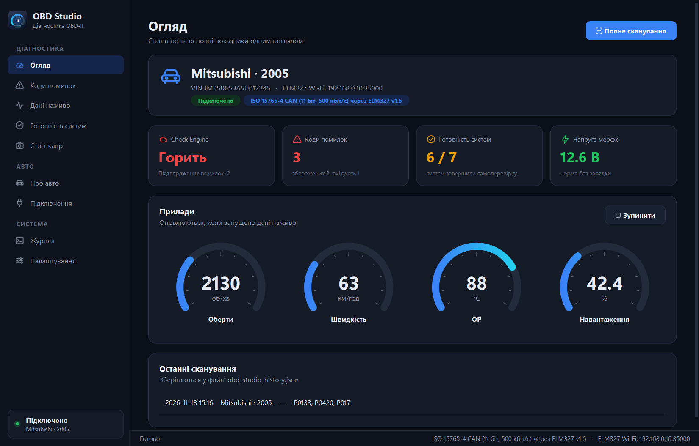

[English](README.md) | **Українська**

# OBD Studio

OBD Studio — безкоштовна програма для Windows, яка перетворює ноутбук і недорогий адаптер на
прилад для діагностики авто. Вона зчитує коди помилок і пояснює їх зрозумілою мовою, показує,
чи горить лампа Check Engine, перевіряє готовність систем самодіагностики (це важливо перед
техоглядом) і виводить дані двигуна наживо — зі стрілочними приладами й графіками. Працює з
будь-якою маркою, що підтримує стандартний OBD-II, через кабель KKL або адаптер ELM327 (USB,
Bluetooth чи Wi-Fi). Встановлювати нічого не треба: завантажте один файл `.exe` і запустіть.



## Можливості

- **Огляд**: марка й рік (за VIN), лампа Check Engine, кількість помилок, готовність систем,
  напруга мережі (ELM327), стрілочні прилади, історія сканувань.
- **Повне сканування** одним натисканням: готовність, збережені коди, коди, що очікують
  підтвердження, постійні (лише CAN), стоп-кадр.
- **Коди помилок** з описом зрозумілою мовою (понад 250 кодів), типом і орієнтовною
  серйозністю; для кодів виробника враховується марка авто.
- **Дані наживо**: понад 50 параметрів (оберти, температури, корекції палива, кисневі датчики,
  тиск, напруга тощо), графік, міні-графіки, вибір параметрів, **запис у CSV**.
- **Стоп-кадр** (режим 02) — умови, за яких виникла помилка.
- **Про авто** (режим 09): VIN, ID калібрування, CVN, назва блока; марка, регіон і модельний
  рік за VIN.
- **Звіт HTML** для друку або збереження в PDF, технічний **журнал** для пошуку проблем.
- Темна й світла теми. Інтерфейс українською та англійською.

## Які адаптери підходять

| Адаптер | Протоколи | Для яких авто |
|---|---|---|
| **Кабель KKL** (VAG KKL 409.1, чип FTDI) | K-лінія: ISO 9141-2, ISO 14230 KWP2000 | переважно до ~2008 р. |
| **ELM327 USB / Bluetooth** | усі протоколи OBD-II, зокрема CAN | будь-які з OBD-II, зокрема 2008 р. і новіші |
| **ELM327 Wi-Fi** | усі протоколи OBD-II, зокрема CAN | будь-які з OBD-II |

Не знаєте, який потрібен саме вам? Дивіться розділ
[«Як вибрати адаптер»](docs/user-guide.uk.md#2-як-вибрати-адаптер) у посібнику.

## Завантаження й запуск

1. Відкрийте [сторінку випусків](https://github.com/DenisKrav/obd-studio/releases) і
   завантажте `OBDStudio.exe` з останнього випуску.
2. Покладіть файл у будь-яку теку (наприклад, `Документи\OBD Studio`) і двічі клацніть його.
   Встановлювати нічого не треба.
3. Windows може показати синє вікно «Windows захистила ваш комп’ютер» (SmartScreen), бо
   програма не має цифрового підпису. Натисніть **«Докладніше» → «Усе одно запустити»**.
   Так буває з усіма непідписаними програмами.

Що потрібно: Windows 10 або 11, кабель KKL або адаптер ELM327.

## Швидкий старт

1. Вставте адаптер у діагностичний роз’єм авто (зазвичай під кермом) і увімкніть
   запалювання. Двигун можна не заводити.
2. Закрийте інші діагностичні програми (VCDS-Lite, Torque тощо) — вони займають порт.
3. Запустіть OBD Studio, відкрийте **Підключення** й виберіть адаптер. Виберіть COM-порт
   (KKL / USB / Bluetooth) або перевірте адресу Wi-Fi (ELM327 Wi-Fi).
4. Натисніть **«Підключитися»**. З кабелем KKL це може тривати до 20 секунд.
5. Відкрийте **Огляд** і натисніть **«Повне сканування»**.

Докладна покрокова інструкція: **[Посібник користувача](docs/user-guide.uk.md)**
([in English](docs/user-guide.en.md)).

## Чи це безпечно для авто?

OBD Studio надсилає **лише стандартні запити OBD-II на читання** (режими 01, 02, 03, 07, 09,
0A). Єдина команда, що змінює стан блока керування, — **стирання кодів помилок** (режим 04), і
програма надсилає її лише після вашого підтвердження. Заводських команд виробників немає:
програма нічого не кодує, не адаптує й не перепрошиває.

## Файли поруч із програмою

Програма зберігає свої файли **в тій самій теці, що й `OBDStudio.exe`**. Якщо переносите
програму, переносьте й ці файли — інакше налаштування та історія почнуться з нуля.

| Файл | Що там |
|---|---|
| `obd_studio_settings.json` | адаптер, порт, марка, тема, мова, параметри даних наживо, часові параметри K-лінії |
| `obd_studio_history.json` | історія сканувань (до 300 записів) |

Налаштування з попередньої версії (`lancer_obd_settings.json`) підхоплюються автоматично.

Тому тримайте програму в теці, куди можна записувати файли (не в `C:\Program Files`).

## Часті запитання

**Список COM-портів порожній.** Не встановлено драйвер адаптера або адаптер не вставлено.
Перевірте «Диспетчер пристроїв» → «Порти (COM і LPT)», потім натисніть кнопку оновлення
поруч зі списком портів.

**Програма не може відкрити порт.** Порт зайнятий іншою програмою. Закрийте VCDS-Lite, Torque
тощо або вийміть і знову вставте адаптер.

**Кабель KKL мовчить.** Кабель живиться від авто: увімкніть запалювання. Без 12 В у роз’ємі
він не відповідає.

**ELM327 не відповідає.** Перевірте, чи вибрано правильний порт. Для Bluetooth потрібен
*вихідний* (Outgoing) COM-порт спареного адаптера.

**«UNABLE TO CONNECT».** Адаптер працює, але авто не відповіло. Увімкніть запалювання,
перевірте, чи щільно сидить штекер, і спробуйте ще раз. Дуже старі авто можуть зовсім не
підтримувати OBD-II.

**Нічого не допомагає.** Відкрийте **Журнал** → **«Зберегти журнал»** і надішліть `.txt` файл
разом із запитанням. Там записано кожен надісланий і отриманий байт, тож проблему можна знайти.

Більше відповідей — у розділі [«Якщо щось не працює»](docs/user-guide.uk.md#11-якщо-щось-не-працює)
посібника.

---

## Для розробника

### Структура

```
main.py                   точка входу
obd_studio/
  config.py               Timing (часові параметри K-лінії), AppSettings, збереження
  protocol.py             контрольна сума, розбір кадрів KWP2000 / ISO 9141-2, ObdError
  kline.py                KLine: кабель KKL, луна, швидкий/повільний старт, перепідключення
  elm327.py               Elm327: USB/Bluetooth/Wi-Fi, AT-команди, CAN і ISO-TP
  obd.py                  ObdClient: режими 01/02/03/04/07/09/0A, готовність систем
  pids.py                 таблиця параметрів режиму 01 (формули, одиниці, діапазони)
  dtc.py                  декодування й опис кодів помилок, серйозність
  vehicles.py             профілі марок, розбір VIN (WMI, рік, регіон, контрольна цифра)
  i18n.py, locales/       мови інтерфейсу (українські рядки в коді, англійські словники)
  history.py, report.py   історія сканувань, HTML-звіт
  resources/              іконка програми
  ui/                     інтерфейс PySide6 (Qt)
    controller.py         черга завдань у фоновому потоці, дані наживо
    main_window.py        вікно, бокове меню, рядок стану
    pages.py              сторінки
    widgets.py            прилад, графіки, плитки
    theme.py, icons.py    теми й векторні іконки
tools/make_icon.py        малює іконку (icon.ico, icon.png)
tests/                    тести pytest (без машини й без адаптера)
original/                 перша чернеткова версія (для порівняння)
build.ps1                 збірка OBDStudio.exe
```

Транспорти `KLine` і `Elm327` мають спільний інтерфейс (`connect`, `request`, `close`,
`is_connected`, `quiet`), тож `ObdClient` і інтерфейс не залежать від адаптера.

### Середовище та тести

Потрібен Python 3.9+ (перевірено на 3.12).

```powershell
py -3 -m venv .venv
.venv\Scripts\python -m pip install -r requirements-dev.txt
.venv\Scripts\python -m pytest -q
.venv\Scripts\python main.py
```

Тести ганяють `KLine` через фальшивий serial-порт (луна кабелю й блок керування) і `Elm327`
через фальшивий адаптер (AT-команди, CAN з кількома блоками, багатокадрові повідомлення
ISO-TP, K-лінія через ELM327). Окремі тести звіряють перенесену логіку з `original/` і
перевіряють, що надсилаються лише дозволені режими OBD-II.

### Гілки та версії

| Гілка | Для чого |
|---|---|
| `dev` | розробка: усі зміни комітяться сюди |
| `prod` | лише перевірені версії для публікації; кожна версія має тег `vX.Y.Z` |

Випуск нової версії:

```powershell
git checkout dev
# 1. підняти __version__ в obd_studio/__init__.py, закомітити
git checkout prod
git merge --no-ff dev -m "Випуск vX.Y.Z"
git tag -a vX.Y.Z -m "OBD Studio X.Y.Z"
powershell -ExecutionPolicy Bypass -File build.ps1   # зібрати OBDStudio.exe з prod
git checkout dev
```

Номер версії: `X` — великі зміни, `Y` — нові функції, `Z` — виправлення.
Що змінилося в кожній версії — у файлі [CHANGELOG.md](CHANGELOG.md).

### Збірка .exe

```powershell
powershell -ExecutionPolicy Bypass -File build.ps1
```

Скрипт створює `.venv` (якщо його немає), ставить залежності, запускає тести, збирає
`dist\OBDStudio.exe` з іконкою й запускає його з `--self-test` (вікно будується й одразу
закривається) для перевірки збірки.

---

Ліцензію ще не визначено.
