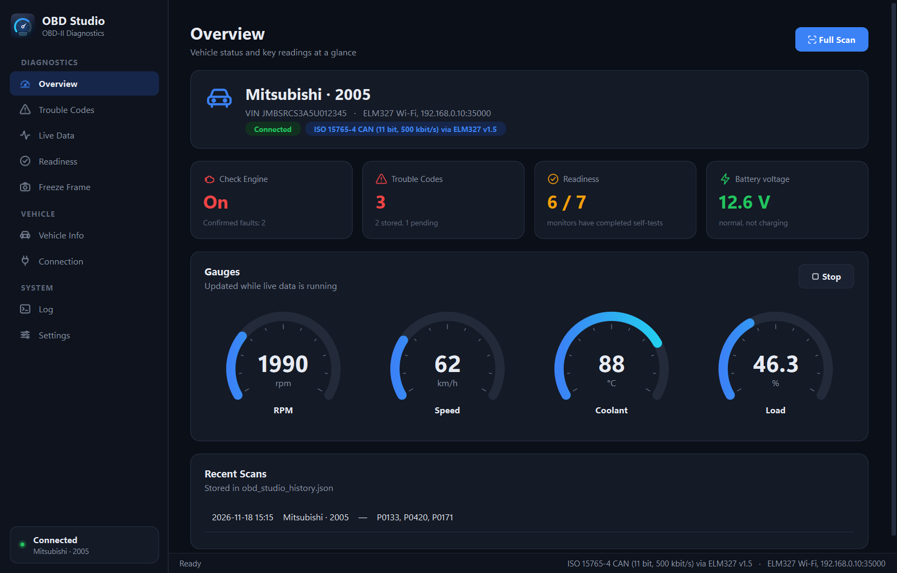
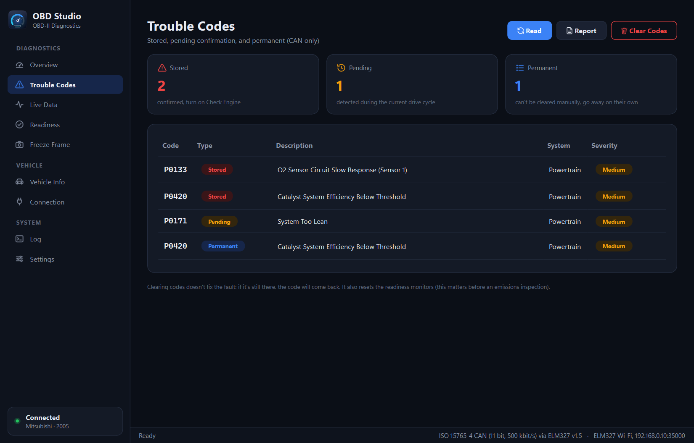
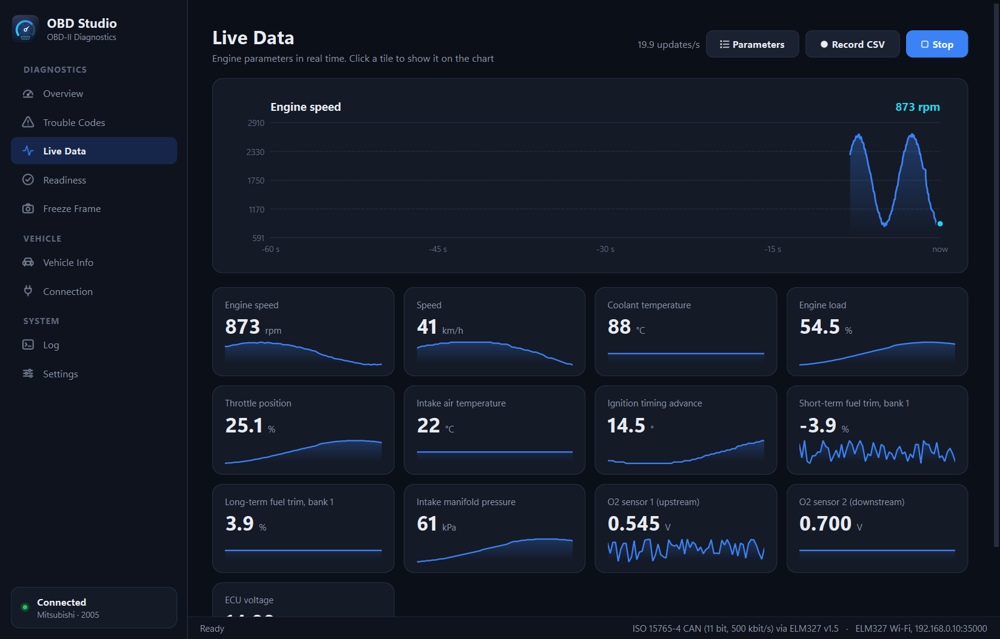
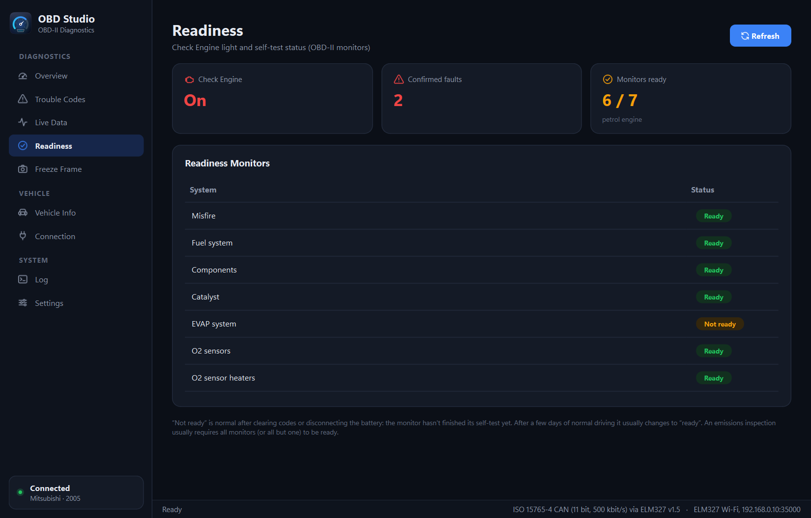
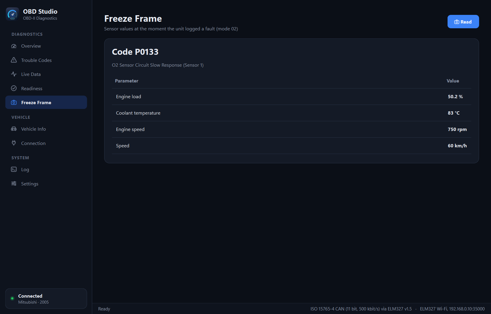
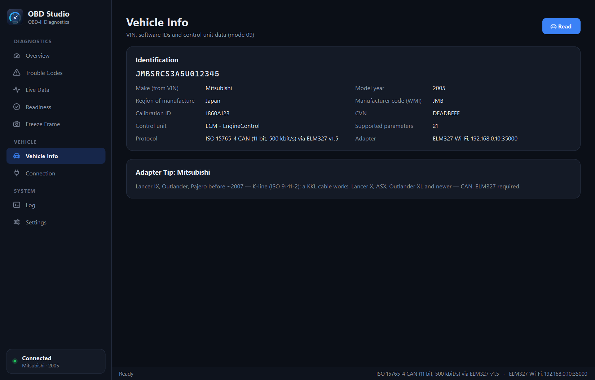
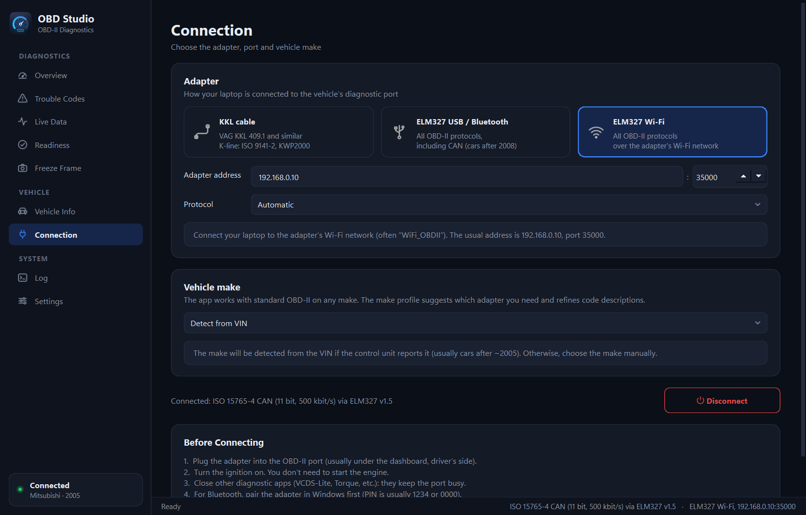
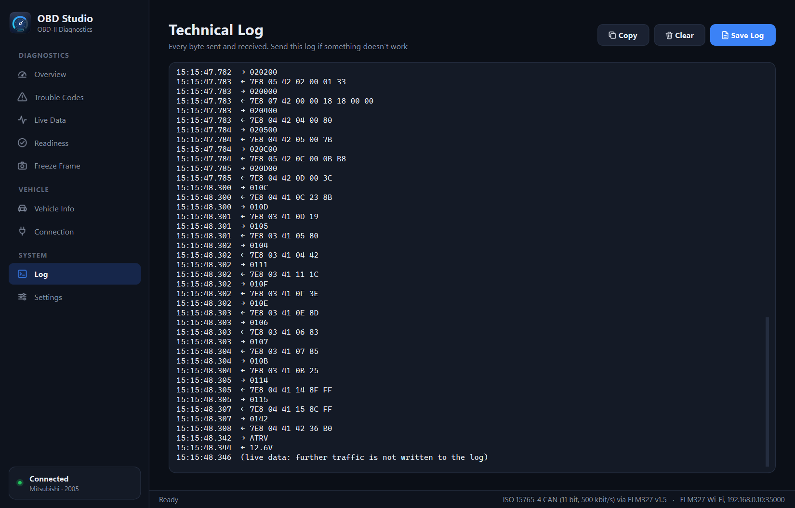
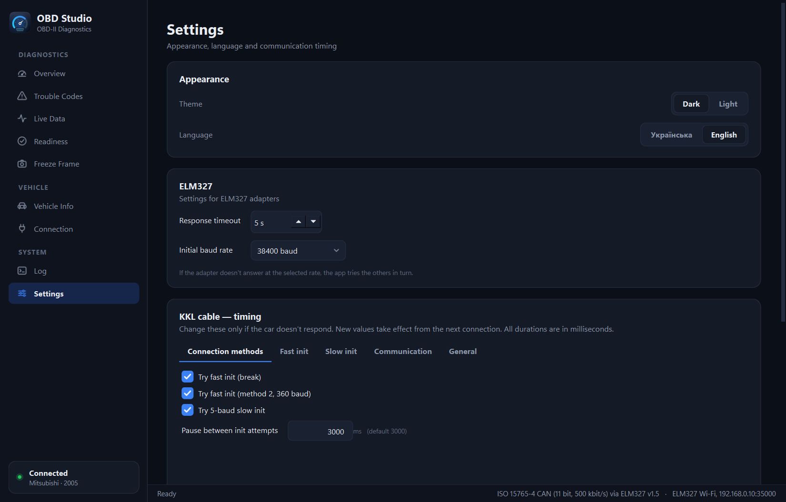

**English** | [Українська](user-guide.uk.md)

# OBD Studio — User Guide

This guide is for car owners. You don't need to be a mechanic or know anything about
protocols. It explains how to pick an adapter, connect to your car, read and clear trouble
codes, watch live engine data and what to do if something doesn't work.

← Back to the [README](../README.md)

## Contents

1. [What you need](#1-what-you-need)
2. [Choosing an adapter](#2-choosing-an-adapter)
3. [Connecting step by step](#3-connecting-step-by-step)
4. [The pages of the app](#4-the-pages-of-the-app)
5. [Reading trouble codes](#5-reading-trouble-codes)
6. [Clearing trouble codes](#6-clearing-trouble-codes)
7. [Live data tips](#7-live-data-tips)
8. [Reports and history](#8-reports-and-history)
9. [KKL cable timing settings](#9-kkl-cable-timing-settings)
10. [Your files](#10-your-files)
11. [Troubleshooting](#11-troubleshooting)
12. [Glossary](#12-glossary)

---

## 1. What you need

- A laptop with **Windows 10 or 11**.
- An **adapter** that connects the laptop to the car: a KKL cable or an ELM327 adapter
  (USB, Bluetooth or Wi-Fi). See the next section to choose.
- The file **`OBDStudio.exe`** from the
  [Releases page](https://github.com/DenisKrav/obd-studio/releases). There is nothing to
  install — just run it. If Windows shows a "Windows protected your PC" window, click
  **More info → Run anyway** (the app is simply not digitally signed).
- A car that supports **OBD-II**. Most petrol cars from about 2001 (Europe) or 1996 (USA)
  and diesel cars from about 2004 do. The diagnostic socket is a 16-pin connector, usually
  under the dashboard on the driver's side.

## 2. Choosing an adapter

| | KKL cable | ELM327 USB / Bluetooth | ELM327 Wi-Fi |
|---|---|---|---|
| Connection to laptop | USB cable | USB cable or Bluetooth | Wi-Fi |
| Protocols | K-line only (ISO 9141-2, KWP2000) | all OBD-II protocols, including CAN | all OBD-II protocols, including CAN |
| Typical cars | mostly before ~2008 | any OBD-II car | any OBD-II car |
| Battery voltage on Overview | no | yes | yes |
| VIN read automatically on connect | no (press **Read** on **Vehicle Info**) | yes | yes |

**How to tell which one your car needs**

- **Cars from about 2008 and newer** almost always use **CAN**. You need an **ELM327**.
  A KKL cable will not work with them.
- **Older cars** (roughly before 2008) often use the **K-line**. Both a **KKL cable** and an
  **ELM327** can work.
- If you're not sure, choose **ELM327**: it supports all OBD-II protocols.
- In the app, the **Vehicle make** card on the **Connection** page shows a short tip for your
  make (for example, which years use the K-line and which use CAN).

**Bluetooth ELM327**

1. Plug the adapter into the car and switch the ignition on (the adapter's light should come on).
2. In Windows open **Settings → Bluetooth & devices → Add device** and pair the adapter.
   The PIN is usually **1234** or **0000**.
3. Windows creates two COM ports for the adapter. In OBD Studio choose the **outgoing**
   (Outgoing) one. You can see which is which in the classic Bluetooth settings
   ("More Bluetooth options" → "COM Ports" tab).

**Wi-Fi ELM327**

1. Plug the adapter into the car and switch the ignition on.
2. Connect the laptop to the adapter's Wi-Fi network (often called something like `WiFi_OBDII`).
   While connected, the laptop usually has no internet — that's normal.
3. The default address is **192.168.0.10**, port **35000**. Change it only if your adapter's
   manual gives a different one.

**KKL cable and the FTDI driver**

Most KKL cables use an FTDI chip and appear in Windows as a "USB Serial Port". Many cheap
cables have a copied chip. New FTDI drivers may refuse to work with such clones. If the
cable isn't detected or behaves strangely, install the older driver from the seller's disc
or page.

## 3. Connecting step by step

1. **Plug the adapter** into the car's diagnostic socket.
2. **Switch the ignition on.** You don't need to start the engine.
   A KKL cable takes its 12 V from the car — without ignition it stays silent.
3. **Close other diagnostic programs** (VCDS-Lite, Torque and similar). Only one program can
   use the port at a time.
4. **Start OBD Studio** and open **Connection** (in the **Vehicle** section of the sidebar).
5. **Choose the adapter**: "KKL cable", "ELM327 USB / Bluetooth" or "ELM327 Wi-Fi".
6. **Choose the port:**
   - KKL or ELM327 USB / Bluetooth — pick the COM port from the list. The app tries to
     preselect the right one by its name. If the list is empty or out of date, click the
     refresh button next to it.
   - ELM327 Wi-Fi — check the adapter address (default `192.168.0.10 : 35000`).
7. **Vehicle make** (optional). Leave **Detect from VIN** to let the app recognise the make from
   the VIN (usually cars from about 2005 on). Or pick your make from the list. The make only
   affects tips and descriptions of manufacturer codes — the requests are always standard OBD-II.
8. Click **Connect**.
   - With a **KKL cable**, connecting can take **up to 20 seconds**: the app tries several
     ways to wake up the control unit one after another.
   - With an **ELM327**, the adapter searches for the right protocol itself.
9. When the connection succeeds, the app opens **Overview**, and the box at the bottom of the
   sidebar shows "Connected". The app immediately reads the Check Engine light and readiness.
   With ELM327 it also reads the battery voltage and the VIN.
10. Click **Full Scan** on the **Overview** page.

To finish, click **Disconnect** on the **Connection** page, or simply close the app.

## 4. The pages of the app

The sidebar has three sections:

| Section | Pages |
|---|---|
| **Diagnostics** | Overview, Trouble Codes, Live Data, Readiness, Freeze Frame |
| **Vehicle** | Vehicle Info, Connection |
| **System** | Log, Settings |

At the bottom of the sidebar you always see the connection status; click it to open
**Connection**. While the app is busy, a thin progress line runs at the top of the window and
the status bar at the bottom says what is happening. If something goes wrong, a message
window appears with a button to open the log.

### Overview

Your car at a glance.

- **Car card**: make and model year (from the VIN), the VIN, the adapter, connection status
  and protocol. When not connected, it has a **Connect** button that takes you to **Connection**.
- **Full Scan** (top right): reads readiness, stored, pending and permanent codes, and the
  freeze frame if there are stored codes. The result is added to the scan history.
- Four tiles:

  | Tile | What it shows |
  |---|---|
  | **Check Engine** | whether the light is on, and how many confirmed codes the car reports |
  | **Trouble Codes** | how many codes the last scan found |
  | **Readiness** | how many self-tests are complete, for example 9 / 11 |
  | **Battery voltage** | measured by the ELM327 adapter (a KKL cable can't measure it) |

  Battery voltage: about **13.2 V or more** means the engine is running and charging; **12.2 V
  or more** is normal with the engine off; less means the battery is low.
- **Gauges**: RPM, speed, coolant temperature and engine load. They move while live data is
  running — use the **Start** / **Stop** button on the card.
- **Recent scans**: the last scans with date, car and codes found.

### Trouble Codes

- **Read** — reads the codes from the control unit.
- **Report** — saves an HTML report (see [Reports and history](#8-reports-and-history)).
- **Clear Codes** — erases the codes after you confirm (see [Clearing trouble codes](#6-clearing-trouble-codes)).

Three tiles show how many **Stored**, **Pending** and **Permanent** codes there are. "n/a"
means the car doesn't support that request (permanent codes exist only on CAN cars).
The table lists each code with its type, a description, the system (engine and transmission,
chassis, body, network) and an estimated **severity** (High / Medium / Low).

### Live Data

- **Start** / **Stop** — starts and stops reading values.
- **Parameters** — choose which values to show. The list contains only the parameters your
  car reports as supported. There is a search box and **All** / **None** buttons.
- **Record CSV** — writes all values to a CSV file.
- The figure in the header shows how many times per second the values are updated.
- Click any tile to show that parameter on the large chart. Each tile also has a small chart.

More in [Live data tips](#7-live-data-tips).

### Readiness

Your car constantly tests its own emission systems (catalyst, oxygen sensors, EVAP and others).
These tests are called **readiness monitors**. This page shows:

- **Check Engine** (on / off), the number of confirmed codes and how many systems are ready,
  plus whether the engine is petrol or diesel;
- a table of all monitors your car supports, each marked **Ready** or **Not ready**.

"Not ready" is normal right after clearing codes or disconnecting the battery: the system
hasn't finished its self-test yet. After a few days of normal driving it usually changes to
"Ready". For a technical inspection, usually all systems (or all but one) must be ready.

The data is read automatically when you connect. Click **Refresh** to read it again.

### Freeze Frame

When the control unit stores a fault, it also saves a "snapshot" of the sensor values at that
moment: RPM, speed, coolant temperature, load and so on. This helps to understand the
conditions in which the fault appeared (cold engine? high speed?).

Click **Read**. The page shows the code that triggered the snapshot and the table of values.
"No freeze frame" usually means there are no confirmed codes. **Full Scan** reads the freeze
frame automatically when it finds stored codes.

### Vehicle Info

Click **Read** to get the VIN and control unit data. The page shows:

| Field | Meaning |
|---|---|
| VIN | the 17-character vehicle identification number |
| Make (from VIN) | recognised from the first characters of the VIN |
| Model year | from the 10th character; sometimes two years are possible (the code repeats every 30 years) |
| Region | where the car was built |
| WMI | manufacturer code (first 3 characters of the VIN) |
| Calibration ID, CVN | software version identifiers of the control unit |
| Control unit | the control unit name, if the car reports it |
| Supported parameters | how many live data parameters the car supports |
| Protocol, Adapter | how the app is connected |

Many European cars built before about 2005 don't support this request. Then the page says so,
and you can choose the make manually on the **Connection** page. Below there is a tip card
about which adapter suits your make.

### Connection

- **Adapter**: "KKL cable", "ELM327 USB / Bluetooth" or "ELM327 Wi-Fi".
- **COM port** (KKL, USB, Bluetooth) with a refresh button, or **adapter address** (Wi-Fi).
- **Protocol** (ELM327 only): leave it on automatic. Pick a specific protocol only if you
  know exactly what your car uses.
- **Vehicle make**: **Detect from VIN** or a make from the list, with a tip about adapters.
- **Connect** / **Disconnect**.
- "Before connecting" — a short checklist.

All choices are saved and restored the next time you start the app.

### Log

A technical record of everything the app does: every byte sent and received, timing values,
measured durations of the wake-up pulses. You don't need to read it, but it is very useful if
something doesn't work.

- **Save Log** — saves the log to a `.txt` file (it also includes the car, VIN, adapter,
  protocol and codes).
- **Copy** — copies the whole log to the clipboard.
- **Clear** — empties the log window.

While live data is running, the constant data exchange is not written to the log, so it
stays readable.

### Settings

- **Appearance**: **Theme** (Dark / Light) and **Language** (English / Ukrainian). On first
  start the app follows the Windows language: Ukrainian Windows → Ukrainian, any other →
  English.
- **ELM327**: how long to wait for the adapter's reply (1–30 s, default 5 s) and the initial
  port speed (default 38400 baud). If the adapter doesn't answer at that speed, the app tries
  the others by itself.
- **KKL cable — timing**: low-level timing for the K-line. Change it only if the car doesn't
  answer — see [KKL cable timing settings](#9-kkl-cable-timing-settings).
- **About**: the version and where the settings and history files are stored.

## 5. Reading trouble codes

The fastest way is **Full Scan** on **Overview**. To read only codes, use **Read** on
**Trouble Codes**.

**What the code means**

A trouble code (DTC) looks like `P0301`. The first letter shows the area:

| Letter | Area |
|---|---|
| **P** | engine and transmission (powertrain) |
| **C** | chassis: ABS, suspension, steering |
| **B** | body: airbags, comfort systems |
| **U** | network: communication between control units |

Codes with **1** as the second character (for example **P1xxx**, and also P30xx–P33xx,
B1/B2, C1/C2, U1/U2) are **manufacturer codes**. Their meaning differs between makes.
The app shows a description when it knows one and otherwise suggests searching the code
together with your make — so it helps to choose the right make on **Connection**.

**Stored, Pending, Permanent**

| Type | What it means |
|---|---|
| **Stored** | confirmed fault; it usually turns the Check Engine light on |
| **Pending** | the car noticed a problem in the current or last drive but hasn't confirmed it yet. If it repeats, it becomes stored |
| **Permanent** | CAN cars only. Can't be erased by hand; the car removes it itself after it checks that the fault is gone |

**Severity is only an estimate.** **High** (for example misfires), **Medium** and **Low**
(for example small fuel vapour leaks) help you decide what to look at first, but they are not
a diagnosis. If the car drives badly, the light flashes, or you're not sure — see a mechanic.

Note: a few older K-line control units don't answer the trouble-code request at all when they
have no codes. If the car itself reports 0 confirmed codes, the app shows 0 stored codes with
the note that the number comes from the readiness data.

## 6. Clearing trouble codes

1. **Switch the engine off and leave the ignition on.**
2. Open **Trouble Codes** and click **Clear Codes**.
3. Read the warning and confirm.
4. After clearing, switch the ignition off and on again.

Important to know:

- **Clearing does not fix the fault.** If the problem is still there, the code will come back
  — sometimes right away, sometimes after a few drives.
- The **freeze frame** is erased too.
- **Readiness monitors are reset** to "Not ready". It takes a few days of normal driving for
  them to become "Ready" again. **Don't clear codes right before a technical inspection**:
  the car may fail it because of unfinished self-tests.
- Permanent codes can't be cleared this way.

If the app says the control unit didn't confirm clearing, make sure the engine is off and try
again.

## 7. Live data tips

- **Fewer parameters = faster updates.** The app asks for each value one by one. On a
  **K-line** (KKL cable or older cars) each request takes noticeable time, so a long list
  updates slowly. Use **Parameters** to keep only what you
  need — for example, just RPM and coolant temperature.
- **Click a tile** to show that parameter on the large chart.
- **Record CSV**: click it, choose where to save the file, and the app starts live data (if
  it isn't running) and writes every update with a timestamp. Click the button again to stop
  recording. The file opens in Excel or LibreOffice Calc (columns are separated by semicolons).
- Your choice of parameters is saved for next time.
- Data is read only while the ignition is on; many values (RPM, fuel trims, oxygen sensors)
  make sense only with the engine running.
- **Safety**: don't look at the laptop while driving. Let a passenger watch it, or record CSV
  and look at it later.

## 8. Reports and history

**Report.** On **Trouble Codes** click **Report**. The app saves an HTML file with the car and
connection details, trouble codes, Check Engine and readiness, the freeze frame and the latest
live data, and opens it in your browser. From the browser you can print it or save it as PDF
(Print → "Save as PDF") — handy to show a mechanic or keep with the car's papers.

**History.** Each **Full Scan** is saved in `obd_studio_history.json` next to the program
(up to 300 entries). The last scans are listed on **Overview** under "Recent scans", so you can
see when a code first appeared or whether it came back after clearing.

## 9. KKL cable timing settings

**Settings → KKL cable — timing** contains the low-level timing for the K-line. **Normally you
never need to change anything.** Touch it only if the car doesn't answer with a KKL cable, and
it's best to save the log first and ask for advice. All durations are in milliseconds. New
values take effect from the next **Connect**. Each field shows its default value next to it,
and **Restore Defaults** brings all of them back; click **Save** to keep your changes.

| Tab | What's there |
|---|---|
| **Connection methods** | which wake-up methods to try (fast init, fast init "method 2" at 360 baud, slow 5-baud init) and the pause between attempts (default 3000 ms) |
| **Fast init** | the fast wake-up pulse: line silence before the pulse (400 ms), low 25 ms, high 25 ms, and the "method 2" settings |
| **Slow init** | the slow 5-baud wake-up: bit length (200 ms), waiting for the 0x55 sync byte, the key bytes and the 0xCC confirmation |
| **Communication** | waiting for a reply (P2, 350 ms), pause between messages (P3min, 60 ms), pause between bytes for ISO 9141 (6 ms), waiting for trouble-code replies (1000 ms), session timeout (4000 ms) and session keep-alive (2000 ms, 0 = off) |
| **General** | K-line speed (10400 baud), port read and echo timeouts |

**Session keep-alive**: a K-line control unit drops the connection after a few seconds of
silence. When the app is idle, it sends a harmless read request (`01 00`) every 2 seconds to
keep the session open. Set it to 0 to turn this off.

## 10. Your files

The app keeps its files **in the same folder as `OBDStudio.exe`**:

| File | What's inside |
|---|---|
| `obd_studio_settings.json` | adapter, port, car make, theme, language, live data parameters, K-line timing |
| `obd_studio_history.json` | scan history (up to 300 entries) |

- **If you move the program to another folder or computer, move these files with it.**
  Otherwise the app starts with default settings and an empty history.
- Keep the program in a folder where you can save files (for example `Documents`), not in
  `C:\Program Files`.
- The exact paths are shown in **Settings → About**.
- Reports, CSV recordings and saved logs go wherever you choose when saving.

## 11. Troubleshooting

**No COM port in the list**

- Check the adapter is plugged into the laptop and click the refresh button next to the list.
- Open Windows **Device Manager** → "Ports (COM & LPT)". If the adapter shows up with a yellow
  warning sign or under "Other devices", its driver is missing. Install the driver from the
  seller (FTDI for most KKL cables, CH340 or PL2303 for many USB ELM327s).
- For Bluetooth, pair the adapter in Windows first.

**The port is busy / can't be opened**

- Close VCDS-Lite, Torque, other OBD programs and serial terminals — only one program can
  use a port at a time.
- Unplug the adapter, wait a few seconds, plug it back in and click refresh.

**KKL cable: no answer from the car**

- The ignition must be **on**. The cable gets its power (12 V) from the car's socket; without
  it the cable stays silent.
- Make sure the car really uses the K-line. Most cars from about 2008 use CAN, and a KKL
  cable can't talk to them — you need an ELM327.
- Connecting with a KKL cable may take up to 20 seconds — wait for it to finish.
- If it still doesn't work, save the log (see below) before changing any timing settings.

**ELM327 doesn't respond**

- Check you chose the correct port. For Bluetooth, use the **outgoing** COM port.
- For Wi-Fi, make sure the laptop is connected to the adapter's Wi-Fi network and the address
  is correct.
- Make sure the adapter is firmly in the socket (its light should be on).
- The app tries different port speeds by itself, so you don't need to guess the speed.
  If the adapter is slow to reply, increase the reply waiting time in **Settings → ELM327**.

**"UNABLE TO CONNECT" or "NO DATA"**

The adapter itself works, but the car's control unit didn't answer.

- Switch the ignition on (or start the engine) and try again.
- Check the plug is pushed fully into the socket.
- Leave **Protocol** on automatic on the **Connection** page.

**My car is not OBD-II**

Some older cars (especially European cars from before about 2001 for petrol and 2004 for
diesel) don't support OBD-II, even if they have a similar socket. The app can't talk to such
cars.

**How to save and send the log**

1. Reproduce the problem (for example, click **Connect** and wait for the error).
2. Open **Log** (in the **System** section).
3. Click **Save Log** and save the `.txt` file.
4. Send the file with a short description: car make, model, year and adapter. You can open an
   issue on [GitHub](https://github.com/DenisKrav/obd-studio/issues).

## 12. Glossary

| Term | Meaning |
|---|---|
| **OBD-II** | On-Board Diagnostics, version 2 — the standard that lets any scan tool read basic engine and emission data from a car |
| **ECU** | Electronic Control Unit — the car's computer (here usually the engine control unit) |
| **DTC** | Diagnostic Trouble Code — a fault code such as `P0301` |
| **MIL** | Malfunction Indicator Lamp — the Check Engine light |
| **PID** | Parameter ID — the number of a live data value (RPM, temperature, …) |
| **K-line** | an older single-wire diagnostic connection (ISO 9141-2, KWP2000), common before ~2008 |
| **CAN** | Controller Area Network — the fast bus used by almost all cars from ~2008 |
| **ELM327** | a popular adapter chip that understands all OBD-II protocols |
| **VIN** | Vehicle Identification Number — the car's unique 17-character number |
| **Freeze frame** | sensor values saved at the moment a fault was stored |
| **Readiness monitors** | the car's self-tests of emission systems; they must be complete ("Ready") for inspection |
