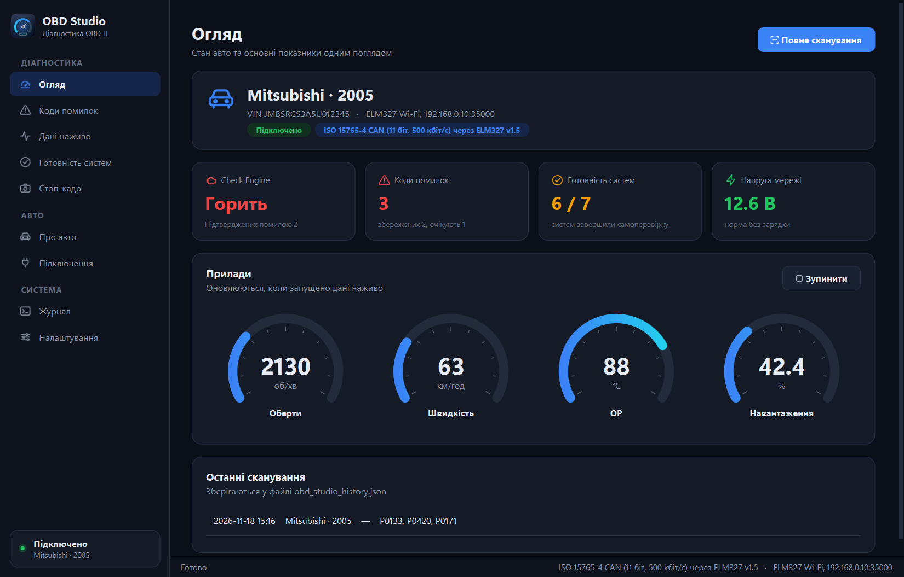
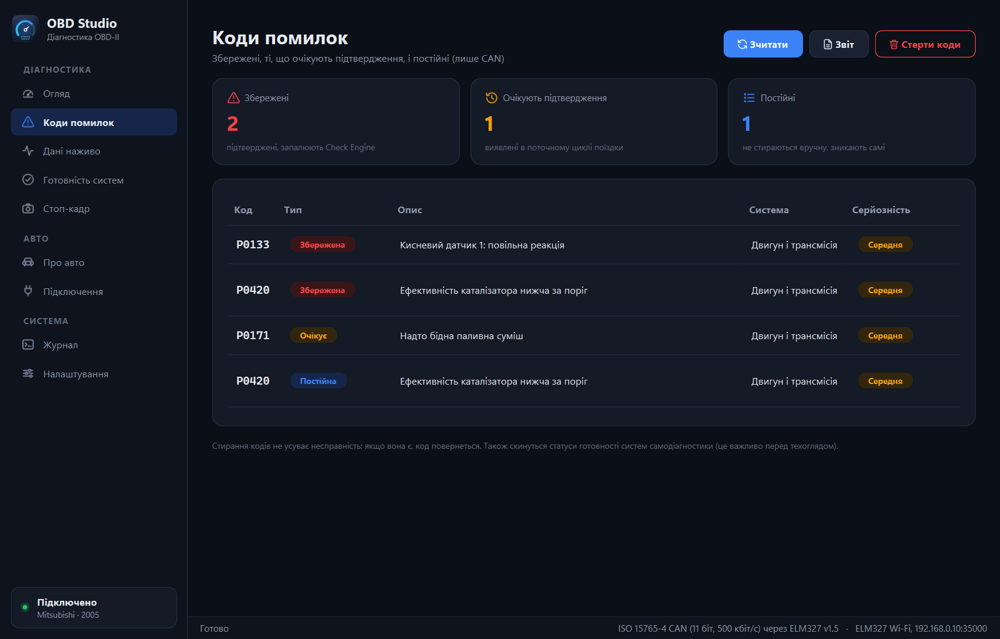
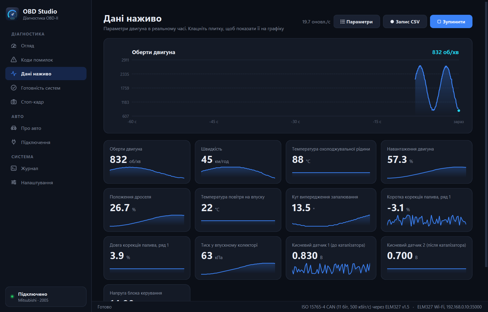
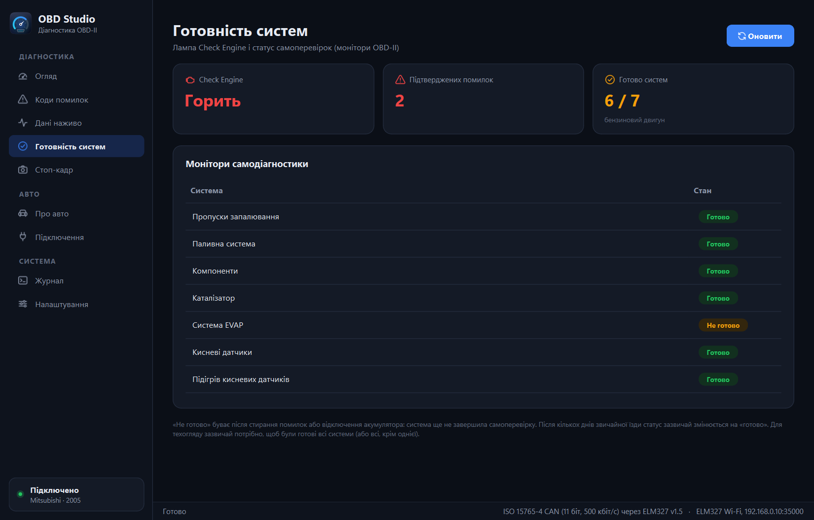
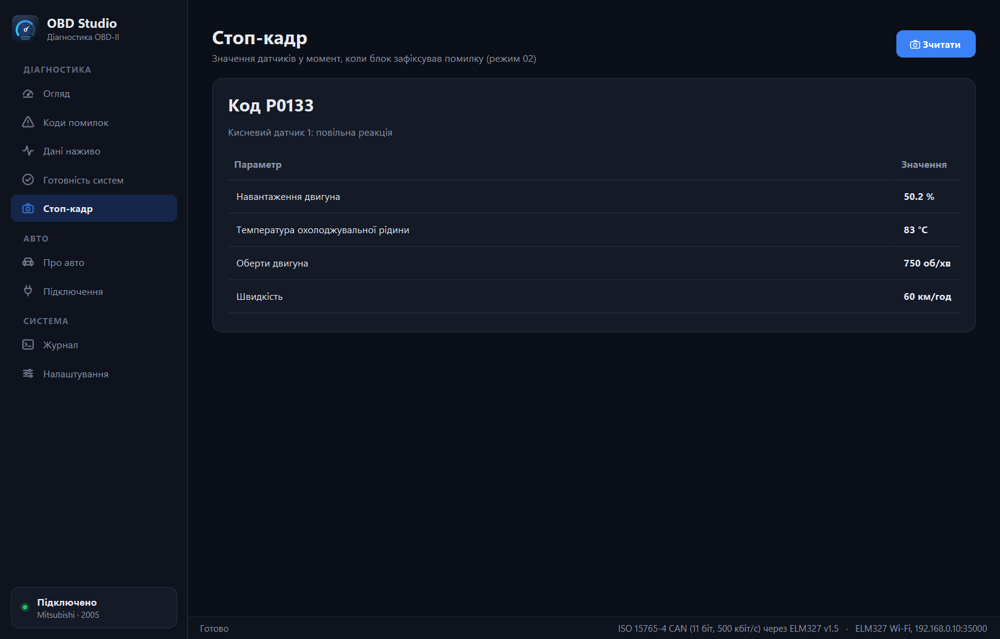
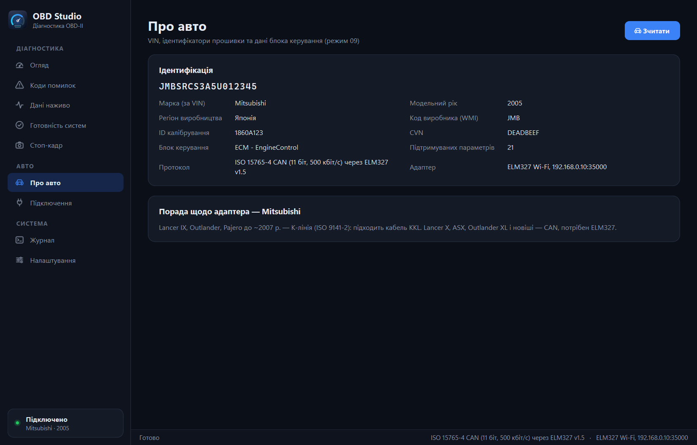
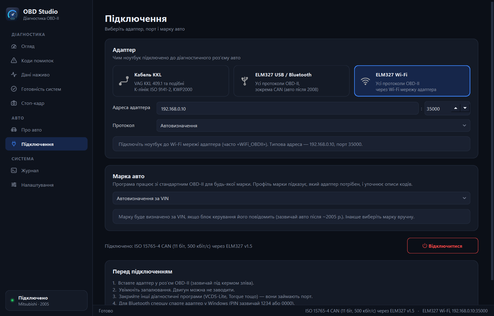
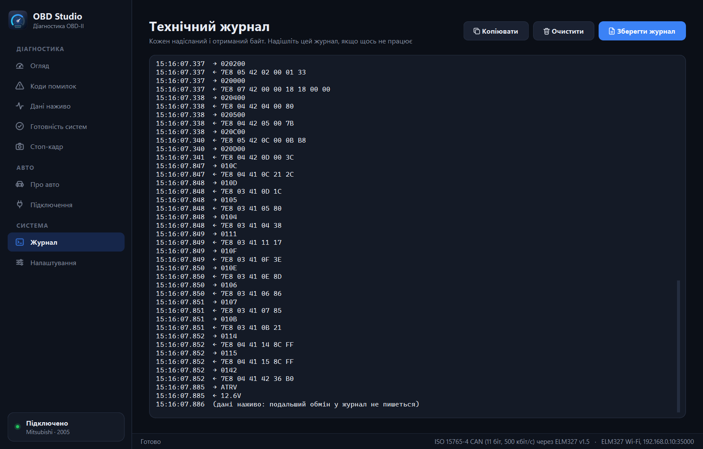
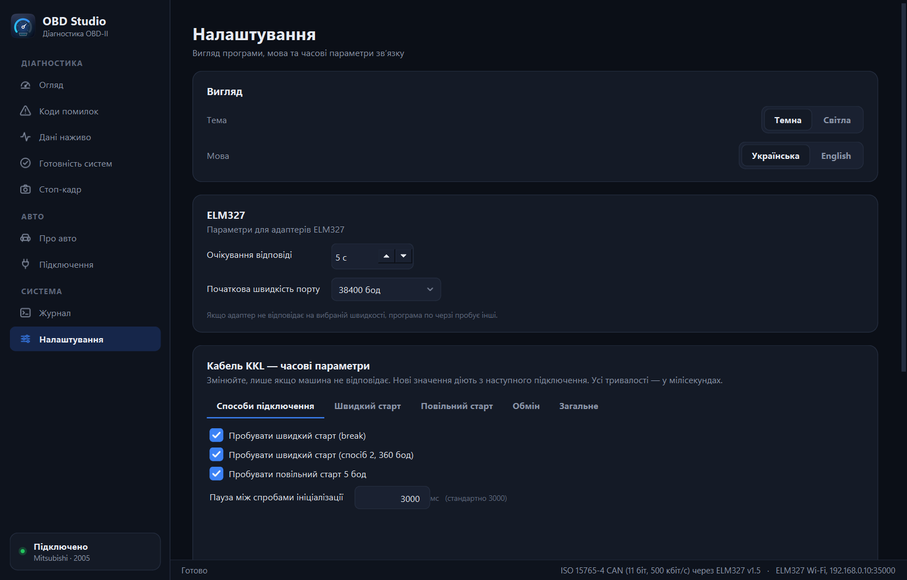

[English](user-guide.en.md) | **Українська**

# OBD Studio — посібник користувача

Цей посібник — для власників авто. Не треба бути механіком чи розумітися на протоколах.
Тут пояснено, як вибрати адаптер, підключитися до авто, зчитати й стерти коди помилок,
дивитися дані двигуна наживо і що робити, якщо щось не працює.

← Назад до [README](../README.uk.md)

## Зміст

1. [Що потрібно](#1-що-потрібно)
2. [Як вибрати адаптер](#2-як-вибрати-адаптер)
3. [Покрокове підключення](#3-покрокове-підключення)
4. [Сторінки програми](#4-сторінки-програми)
5. [Зчитування кодів помилок](#5-зчитування-кодів-помилок)
6. [Стирання кодів помилок](#6-стирання-кодів-помилок)
7. [Поради щодо даних наживо](#7-поради-щодо-даних-наживо)
8. [Звіти та історія](#8-звіти-та-історія)
9. [Часові параметри кабелю KKL](#9-часові-параметри-кабелю-kkl)
10. [Ваші файли](#10-ваші-файли)
11. [Якщо щось не працює](#11-якщо-щось-не-працює)
12. [Словник термінів](#12-словник-термінів)

---

## 1. Що потрібно

- Ноутбук з **Windows 10 або 11**.
- **Адаптер**, що з’єднує ноутбук з авто: кабель KKL або адаптер ELM327 (USB, Bluetooth чи
  Wi-Fi). Як вибрати — у наступному розділі.
- Файл **`OBDStudio.exe`** зі [сторінки випусків](https://github.com/DenisKrav/obd-studio/releases).
  Встановлювати нічого не треба — просто запустіть. Якщо Windows покаже вікно «Windows захистила
  ваш комп’ютер», натисніть **«Докладніше» → «Усе одно запустити»** (у програми просто немає
  цифрового підпису).
- Авто з підтримкою **OBD-II**. Її мають більшість бензинових авто приблизно з 2001 р.
  (Європа) чи 1996 р. (США) і дизельних — приблизно з 2004 р. Діагностичний роз’єм —
  16-контактна колодка, зазвичай під панеллю з боку водія.

## 2. Як вибрати адаптер

| | Кабель KKL | ELM327 USB / Bluetooth | ELM327 Wi-Fi |
|---|---|---|---|
| Підключення до ноутбука | USB-кабель | USB-кабель або Bluetooth | Wi-Fi |
| Протоколи | лише K-лінія (ISO 9141-2, KWP2000) | усі протоколи OBD-II, зокрема CAN | усі протоколи OBD-II, зокрема CAN |
| Для яких авто | переважно до ~2008 р. | будь-які з OBD-II | будь-які з OBD-II |
| Напруга мережі на «Огляді» | ні | так | так |
| VIN зчитується одразу після підключення | ні (натисніть **«Зчитати»** на сторінці **«Про авто»**) | так | так |

**Як зрозуміти, що потрібно вашому авто**

- **Авто приблизно з 2008 р. і новіші** майже завжди мають **CAN**. Потрібен **ELM327** —
  кабель KKL з ними не працюватиме.
- **Старіші авто** (приблизно до 2008 р.) часто мають **K-лінію**. Підійдуть і **кабель
  KKL**, і **ELM327**.
- Якщо сумніваєтеся, беріть **ELM327**: він підтримує всі протоколи OBD-II.
- У програмі на сторінці **«Підключення»** картка **«Марка авто»** показує коротку підказку
  для вашої марки (наприклад, у яких роках K-лінія, а в яких — CAN).

**ELM327 Bluetooth**

1. Вставте адаптер у роз’єм авто й увімкніть запалювання (на адаптері має засвітитися індикатор).
2. У Windows відкрийте **«Параметри» → «Bluetooth і пристрої» → «Додати пристрій»** і спарте
   адаптер. PIN зазвичай **1234** або **0000**.
3. Windows створить для адаптера два COM-порти. У OBD Studio виберіть **вихідний** (Outgoing).
   Який із них який, видно в класичних налаштуваннях Bluetooth («Інші параметри Bluetooth» →
   вкладка «COM-порти»).

**ELM327 Wi-Fi**

1. Вставте адаптер у роз’єм авто й увімкніть запалювання.
2. Підключіть ноутбук до Wi-Fi мережі адаптера (часто вона називається на кшталт `WiFi_OBDII`).
   Поки ноутбук підключено до адаптера, інтернету зазвичай немає — це нормально.
3. Типова адреса — **192.168.0.10**, порт **35000**. Змінюйте, лише якщо в інструкції до
   адаптера вказано інше.

**Кабель KKL і драйвер FTDI**

Більшість кабелів KKL мають чип FTDI і з’являються у Windows як «USB Serial Port». Багато
дешевих кабелів мають підробний чип, а нові драйвери FTDI можуть відмовлятися з ним працювати.
Якщо кабель не визначається або поводиться дивно, встановіть старий драйвер із диска чи
сторінки продавця.

## 3. Покрокове підключення

1. **Вставте адаптер** у діагностичний роз’єм авто.
2. **Увімкніть запалювання.** Двигун можна не заводити.
   Кабель KKL живиться від авто (12 В) — без запалювання він мовчить.
3. **Закрийте інші діагностичні програми** (VCDS-Lite, Torque тощо). Порт може використовувати
   лише одна програма.
4. **Запустіть OBD Studio** і відкрийте **«Підключення»** (розділ **«Авто»** в боковому меню).
5. **Виберіть адаптер**: «Кабель KKL», «ELM327 USB / Bluetooth» або «ELM327 Wi-Fi».
6. **Виберіть порт:**
   - KKL або ELM327 USB / Bluetooth — виберіть COM-порт зі списку. Програма намагається сама
     підставити потрібний за його назвою. Якщо список порожній чи застарів, натисніть кнопку
     оновлення поруч.
   - ELM327 Wi-Fi — перевірте адресу адаптера (типово `192.168.0.10 : 35000`).
7. **Марка авто** (за бажанням). Залиште **«Автовизначення за VIN»** — і програма визначить марку
   за VIN (зазвичай авто приблизно з 2005 р.). Або виберіть марку зі списку. Марка впливає лише
   на підказки й описи кодів виробника — запити завжди стандартні OBD-II.
8. Натисніть **«Підключитися»**.
   - З **кабелем KKL** підключення може тривати **до 20 секунд**: програма по черзі пробує
     кілька способів «розбудити» блок керування.
   - **ELM327** сам шукає потрібний протокол.
9. Коли зв’язок встановлено, програма відкриває **«Огляд»**, а внизу бокового меню з’являється
   «Підключено». Програма одразу зчитує стан лампи Check Engine і готовність систем. З ELM327 —
   ще й напругу мережі та VIN.
10. На сторінці **«Огляд»** натисніть **«Повне сканування»**.

Щоб завершити, натисніть **«Відключитися»** на сторінці **«Підключення»** або просто закрийте
програму.

## 4. Сторінки програми

Бокове меню має три розділи:

| Розділ | Сторінки |
|---|---|
| **Діагностика** | Огляд, Коди помилок, Дані наживо, Готовність систем, Стоп-кадр |
| **Авто** | Про авто, Підключення |
| **Система** | Журнал, Налаштування |

Унизу бокового меню завжди видно стан підключення; клацніть його, щоб відкрити
**«Підключення»**. Поки програма працює, угорі вікна біжить тонка смужка, а рядок стану внизу
пише, що саме відбувається. Якщо щось піде не так, з’явиться вікно з повідомленням і кнопкою,
що відкриває журнал.

### Огляд

Стан авто одним поглядом.

- **Картка авто**: марка й модельний рік (за VIN), VIN, адаптер, стан підключення та протокол.
  Без підключення на ній є кнопка **«Підключитися»**, що веде на сторінку **«Підключення»**.
- **«Повне сканування»** (угорі праворуч): зчитує готовність систем, збережені коди, коди, що
  очікують підтвердження, постійні коди, а якщо є збережені коди — ще й стоп-кадр. Результат
  додається в історію сканувань.
- Чотири плитки:

  | Плитка | Що показує |
  |---|---|
  | **Check Engine** | чи горить лампа і скільки підтверджених помилок повідомляє авто |
  | **Коди помилок** | скільки кодів знайдено під час останнього зчитування |
  | **Готовність систем** | скільки самоперевірок завершено, наприклад 9 / 11 |
  | **Напруга мережі** | вимірює адаптер ELM327 (кабель KKL цього не вміє) |

  Напруга: приблизно **13,2 В і більше** — двигун працює, зарядка є; **12,2 В і більше** —
  норма із заглушеним двигуном; менше — акумулятор розряджений.
- **Прилади**: оберти, швидкість, температура охолоджувальної рідини й навантаження. Стрілки
  рухаються, коли запущено дані наживо — кнопка **«Запустити»** / **«Зупинити»** на картці.
- **Останні сканування**: дата, авто й знайдені коди.

### Коди помилок

- **«Зчитати»** — зчитує коди з блока керування.
- **«Звіт»** — зберігає HTML-звіт (див. [«Звіти та історія»](#8-звіти-та-історія)).
- **«Стерти коди»** — стирає коди після підтвердження (див. [«Стирання кодів помилок»](#6-стирання-кодів-помилок)).

Три плитки показують, скільки є кодів: **Збережена**, **Очікує**, **Постійна**. «н/д» означає,
що авто не підтримує цей запит (постійні коди бувають лише в авто з CAN). У таблиці для
кожного коду вказано тип, опис, систему (двигун і трансмісія, шасі, кузов, мережа зв’язку) та
орієнтовну **серйозність** (Висока / Середня / Низька).

### Дані наживо

- **«Запустити»** / **«Зупинити»** — вмикає й вимикає зчитування.
- **«Параметри»** — вибір значень для показу. У списку лише ті параметри, які підтримує ваше
  авто. Є пошук і кнопки «Усі» / «Жодного».
- **«Запис CSV»** — записує всі значення у файл CSV.
- Число в заголовку показує, скільки разів на секунду оновлюються значення.
- Клацніть будь-яку плитку, щоб показати цей параметр на великому графіку. На кожній плитці є
  ще й маленький графік.

Докладніше — у розділі [«Поради щодо даних наживо»](#7-поради-щодо-даних-наживо).

### Готовність систем

Авто постійно перевіряє власні системи, що відповідають за викиди (каталізатор, кисневі
датчики, EVAP тощо). Ці самоперевірки називають **моніторами готовності**. На сторінці видно:

- **Check Engine** (горить / не горить), кількість підтверджених помилок і скільки систем
  готово, а також тип двигуна (бензиновий чи дизельний);
- таблицю всіх моніторів, які підтримує ваше авто, з позначкою **«Готово»** або **«Не готово»**.

«Не готово» — нормально одразу після стирання помилок або відключення акумулятора: система ще
не завершила самоперевірку. Після кількох днів звичайної їзди статус зазвичай змінюється на
«Готово». Для техогляду зазвичай потрібно, щоб були готові всі системи (або всі, крім однієї).

Дані зчитуються автоматично під час підключення. Щоб зчитати ще раз, натисніть **«Оновити»**.

### Стоп-кадр

Коли блок керування записує помилку, він також зберігає «знімок» показів датчиків у цю мить:
оберти, швидкість, температуру, навантаження тощо. Це допомагає зрозуміти, за яких умов
виникла несправність (холодний двигун? висока швидкість?).

Натисніть **«Зчитати»**. Сторінка покаже код, через який збережено знімок, і таблицю значень.
«Стоп-кадру немає» зазвичай означає, що підтверджених помилок немає. **«Повне сканування»**
зчитує стоп-кадр автоматично, якщо знайдено збережені коди.

### Про авто

Натисніть **«Зчитати»**, щоб отримати VIN і дані блока керування. На сторінці:

| Поле | Що це |
|---|---|
| VIN | 17-значний ідентифікаційний номер авто |
| Марка (за VIN) | визначається за першими символами VIN |
| Модельний рік | за 10-м символом; іноді можливі два роки (код повторюється кожні 30 років) |
| Регіон виробництва | де зібрано авто |
| Код виробника (WMI) | перші 3 символи VIN |
| ID калібрування, CVN | ідентифікатори версії програми блока керування |
| Блок керування | назва блока, якщо авто її повідомляє |
| Підтримуваних параметрів | скільки параметрів даних наживо підтримує авто |
| Протокол, Адаптер | як програма підключена |

Багато європейських авто, вироблених приблизно до 2005 р., цього запиту не підтримують. Тоді
сторінка про це скаже, і марку можна вибрати вручну на сторінці **«Підключення»**. Нижче є
картка з порадою, який адаптер підходить вашій марці.

### Підключення

- **Адаптер**: «Кабель KKL», «ELM327 USB / Bluetooth» або «ELM327 Wi-Fi».
- **COM-порт** (KKL, USB, Bluetooth) з кнопкою оновлення або **адреса адаптера** (Wi-Fi).
- **Протокол** (лише ELM327): залиште автовизначення. Конкретний протокол вибирайте, лише якщо
  точно знаєте, який у вашого авто.
- **«Марка авто»**: **«Автовизначення за VIN»** або марка зі списку, з підказкою щодо адаптера.
- **«Підключитися»** / **«Відключитися»**.
- «Перед підключенням» — короткий перелік, що перевірити.

Усе вибране зберігається й відновлюється під час наступного запуску.

### Журнал

Технічний запис усього, що робить програма: кожен надісланий і отриманий байт, часові
параметри, виміряні тривалості імпульсів ініціалізації. Читати його не обов’язково, але він
дуже допомагає, якщо щось не працює.

- **«Зберегти журнал»** — зберігає журнал у файл `.txt` (туди ж потрапляють авто, VIN, адаптер,
  протокол і коди).
- **«Копіювати»** — копіює весь журнал у буфер обміну.
- **«Очистити»** — очищає вікно журналу.

Поки працюють дані наживо, постійний обмін у журнал не пишеться, щоб він лишався читабельним.

### Налаштування

- **Вигляд**: **Тема** (Темна / Світла) і **Мова** (українська / англійська). Під час першого
  запуску програма бере мову Windows: українська Windows — українська мова, будь-яка інша —
  англійська.
- **ELM327**: скільки чекати відповіді адаптера (1–30 с, типово 5 с) і початкова швидкість
  порту (типово 38400 бод). Якщо на цій швидкості адаптер не відповідає, програма сама пробує
  інші.
- **«Кабель KKL — часові параметри»**: тонкі налаштування K-лінії. Змінюйте, лише якщо авто не
  відповідає, — див. [«Часові параметри кабелю KKL»](#9-часові-параметри-кабелю-kkl).
- **Про програму**: версія і де лежать файли налаштувань та історії.

## 5. Зчитування кодів помилок

Найшвидше — **«Повне сканування»** на сторінці **«Огляд»**. Щоб зчитати лише коди, натисніть
**«Зчитати»** на сторінці **«Коди помилок»**.

**Що означає код**

Код помилки (DTC) має вигляд `P0301`. Перша літера показує систему:

| Літера | Система |
|---|---|
| **P** | двигун і трансмісія |
| **C** | шасі: ABS, підвіска, кермо |
| **B** | кузов: подушки безпеки, системи комфорту |
| **U** | мережа зв’язку між блоками керування |

Коди, де другий символ **1** (наприклад, **P1xxx**, а також P30xx–P33xx, B1/B2, C1/C2, U1/U2), —
це **коди виробника**. У різних марок вони означають різне. Якщо програма знає опис, вона його
покаже, а інакше підкаже шукати код разом із назвою марки. Тому варто вибрати правильну марку
на сторінці **«Підключення»**.

**Збережена, Очікує, Постійна**

| Тип | Що означає |
|---|---|
| **Збережена** | підтверджена несправність; зазвичай вмикає лампу Check Engine |
| **Очікує** | авто помітило проблему в поточній чи минулій поїздці, але ще не підтвердило. Якщо вона повториться, код стане збереженим |
| **Постійна** | лише в авто з CAN. Вручну не стирається; авто прибирає код саме, коли переконається, що несправності вже немає |

**Серйозність — лише орієнтир.** **Висока** (наприклад, пропуски запалювання), **Середня** і
**Низька** (наприклад, невеликий витік парів палива) допомагають зрозуміти, на що зважати
насамперед, але це не діагноз. Якщо авто їде погано, лампа блимає або ви не впевнені —
зверніться до майстра.

Примітка: деякі старі блоки з K-лінією зовсім не відповідають на запит кодів, коли кодів немає.
Якщо саме авто повідомляє 0 підтверджених помилок, програма покаже 0 збережених кодів із
приміткою, що число взято з даних про готовність систем.

## 6. Стирання кодів помилок

1. **Заглушіть двигун, запалювання залиште увімкненим.**
2. Відкрийте **«Коди помилок»** і натисніть **«Стерти коди»**.
3. Прочитайте попередження й підтвердьте.
4. Після стирання вимкніть і знову увімкніть запалювання.

Що важливо знати:

- **Стирання не усуває несправність.** Якщо проблема лишилася, код повернеться — інколи
  одразу, інколи після кількох поїздок.
- **Стоп-кадр** теж стирається.
- **Статуси готовності систем скидаються** на «Не готово». Щоб вони знову стали «Готово»,
  потрібно кілька днів звичайної їзди. **Не стирайте коди безпосередньо перед техоглядом**:
  авто може його не пройти через незавершені самоперевірки.
- Постійні коди так не стираються.

Якщо програма пише, що блок не підтвердив стирання, переконайтеся, що двигун заглушено, і
спробуйте ще раз.

## 7. Поради щодо даних наживо

- **Що менше параметрів, то частіше оновлення.** Програма запитує значення по одному. На
  **K-лінії** (кабель KKL або старіші авто) кожен запит займає помітний час, тож довгий список
  оновлюється повільно. Кнопкою **«Параметри»** залиште лише потрібне — наприклад, оберти й
  температуру охолоджувальної рідини.
- **Клацніть плитку**, щоб показати параметр на великому графіку.
- **«Запис CSV»**: натисніть, виберіть, куди зберегти файл, — і програма запустить дані наживо
  (якщо їх ще не запущено) та записуватиме кожне оновлення з часом. Щоб зупинити запис,
  натисніть кнопку ще раз. Файл відкривається в Excel чи LibreOffice Calc (стовпці розділено
  крапкою з комою).
- Вибрані параметри зберігаються на наступний раз.
- Дані зчитуються лише з увімкненим запалюванням; багато значень (оберти, корекції палива,
  кисневі датчики) мають сенс лише з працюючим двигуном.
- **Безпека**: не дивіться на ноутбук за кермом. Нехай стежить пасажир, або запишіть CSV і
  перегляньте пізніше.

## 8. Звіти та історія

**Звіт.** На сторінці **«Коди помилок»** натисніть **«Звіт»**. Програма збереже HTML-файл з
даними авто й підключення, кодами помилок, станом Check Engine і готовності систем, стоп-кадром
та останніми даними наживо — і відкриє його в браузері. Звідти його можна надрукувати або
зберегти в PDF («Друк» → «Зберегти як PDF»). Зручно, щоб показати майстрові чи зберегти разом
із документами на авто.

**Історія.** Кожне **«Повне сканування»** зберігається у файлі `obd_studio_history.json` поруч
із програмою (до 300 записів). Останні сканування видно на сторінці **«Огляд»** у картці
«Останні сканування» — так можна побачити, коли код з’явився вперше і чи повернувся він після
стирання.

## 9. Часові параметри кабелю KKL

**«Налаштування» → «Кабель KKL — часові параметри»** містить тонкі налаштування K-лінії.
**Зазвичай нічого змінювати не треба.** Чіпайте їх, лише якщо авто не відповідає через кабель
KKL, і краще спершу збережіть журнал і порадьтеся. Усі тривалості — у мілісекундах. Нові
значення діють з наступного натискання **«Підключитися»**. Поруч із кожним полем указано
стандартне значення; кнопка **«Стандартні значення»** повертає всі їх, а **«Зберегти»** —
зберігає ваші зміни.

| Вкладка | Що там |
|---|---|
| **Способи підключення** | які способи «пробудження» пробувати (швидкий старт, швидкий старт «спосіб 2» на 360 бод, повільний старт 5 бод) і пауза між спробами (типово 3000 мс) |
| **Швидкий старт** | імпульс швидкого старту: тиша на лінії перед імпульсом (400 мс), нуль 25 мс, одиниця 25 мс, параметри «способу 2» |
| **Повільний старт** | повільний старт 5 бод: тривалість біта (200 мс), очікування байта синхронізації 0x55, ключових байтів і підтвердження 0xCC |
| **Обмін** | очікування відповіді (P2, 350 мс), пауза між повідомленнями (P3min, 60 мс), пауза між байтами для ISO 9141 (6 мс), очікування відповіді на запит кодів (1000 мс), тайм-аут сесії (4000 мс) і підтримка сесії (2000 мс, 0 — вимкнено) |
| **Загальне** | швидкість K-лінії (10400 бод), тайм-аути читання з порту та луни |

**Підтримка сесії**: блок керування на K-лінії розриває зв’язок після кількох секунд тиші.
Поки програма простоює, вона кожні 2 секунди надсилає безпечний запит на читання (`01 00`), щоб
сесія не згасла. Щоб вимкнути це, поставте 0.

## 10. Ваші файли

Програма зберігає свої файли **в тій самій теці, що й `OBDStudio.exe`**:

| Файл | Що там |
|---|---|
| `obd_studio_settings.json` | адаптер, порт, марка, тема, мова, параметри даних наживо, часові параметри K-лінії |
| `obd_studio_history.json` | історія сканувань (до 300 записів) |

- **Якщо переносите програму в іншу теку чи на інший комп’ютер, переносьте й ці файли.**
  Інакше програма запуститься зі стандартними налаштуваннями й порожньою історією.
- Тримайте програму в теці, куди можна записувати файли (наприклад, у «Документах»), а не в
  `C:\Program Files`.
- Точні шляхи видно в **«Налаштування» → «Про програму»**.
- Звіти, записи CSV і журнали зберігаються туди, куди ви вкажете під час збереження.

## 11. Якщо щось не працює

**У списку немає COM-порту**

- Перевірте, чи вставлено адаптер у ноутбук, і натисніть кнопку оновлення поруч зі списком.
- Відкрийте **«Диспетчер пристроїв»** Windows → «Порти (COM і LPT)». Якщо адаптер має жовтий
  знак оклику або опинився в «Інших пристроях», бракує драйвера. Встановіть драйвер від продавця
  (FTDI для більшості кабелів KKL, CH340 або PL2303 для багатьох USB-адаптерів ELM327).
- Bluetooth-адаптер спершу спарте у Windows.

**Порт зайнятий або не відкривається**

- Закрийте VCDS-Lite, Torque, інші програми OBD і термінали — порт може використовувати лише
  одна програма.
- Вийміть адаптер, зачекайте кілька секунд, вставте знову й натисніть кнопку оновлення.

**Кабель KKL: авто не відповідає**

- Запалювання має бути **увімкнене**. Кабель живиться (12 В) від роз’єму авто; без цього він
  мовчить.
- Переконайтеся, що авто справді має K-лінію. Більшість авто приблизно з 2008 р. мають CAN, і
  кабель KKL з ними не працює — потрібен ELM327.
- Підключення через KKL може тривати до 20 секунд — дочекайтеся завершення.
- Якщо все одно не виходить, збережіть журнал (див. нижче), перш ніж змінювати часові
  параметри.

**ELM327 не відповідає**

- Перевірте, чи вибрано правильний порт. Для Bluetooth потрібен **вихідний** COM-порт.
- Для Wi-Fi переконайтеся, що ноутбук підключено до мережі адаптера і що адреса правильна.
- Перевірте, чи щільно адаптер сидить у роз’ємі (індикатор має світитися).
- Швидкість порту програма підбирає сама, вгадувати її не треба. Якщо адаптер відповідає
  повільно, збільште час очікування відповіді в **«Налаштування» → ELM327**.

**«UNABLE TO CONNECT» або «NO DATA»**

Сам адаптер працює, але блок керування авто не відповів.

- Увімкніть запалювання (або заведіть двигун) і спробуйте ще раз.
- Перевірте, чи штекер вставлено в роз’єм до кінця.
- На сторінці **«Підключення»** залиште **Протокол** на автовизначенні.

**Авто не підтримує OBD-II**

Деякі старі авто (особливо європейські бензинові приблизно до 2001 р. і дизельні до 2004 р.)
не підтримують OBD-II, навіть якщо мають схожий роз’єм. З такими авто програма зв’язатися не
зможе.

**Як зберегти й надіслати журнал**

1. Повторіть проблему (наприклад, натисніть **«Підключитися»** й дочекайтеся помилки).
2. Відкрийте **«Журнал»** (розділ **«Система»**).
3. Натисніть **«Зберегти журнал»** і збережіть файл `.txt`.
4. Надішліть файл із коротким описом: марка, модель, рік авто й адаптер. Можна створити
   звернення (issue) на [GitHub](https://github.com/DenisKrav/obd-studio/issues).

## 12. Словник термінів

| Термін | Що означає |
|---|---|
| **OBD-II** | бортова діагностика, версія 2 — стандарт, що дає будь-якому сканеру зчитати основні дані двигуна й системи викидів |
| **ECU** | електронний блок керування — «комп’ютер» авто (тут зазвичай блок керування двигуном) |
| **DTC** | код помилки, наприклад `P0301` |
| **MIL** | лампа несправності — та сама Check Engine |
| **PID** | номер параметра даних наживо (оберти, температура тощо) |
| **K-лінія** | старіший однопровідний діагностичний зв’язок (ISO 9141-2, KWP2000), поширений до ~2008 р. |
| **CAN** | швидка шина зв’язку, яку мають майже всі авто приблизно з 2008 р. |
| **ELM327** | поширений чип адаптера, що розуміє всі протоколи OBD-II |
| **VIN** | унікальний 17-значний ідентифікаційний номер авто |
| **Стоп-кадр** | покази датчиків, збережені в мить, коли записано помилку |
| **Монітори готовності** | самоперевірки систем, що відповідають за викиди; для техогляду вони мають бути завершені («Готово») |
